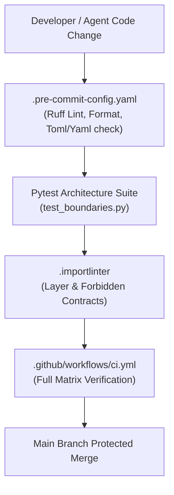

# ADR 0002: Domain Scope and Boundary Enforcement Mechanics

* **Status:** Accepted
* **Date:** 2026-11-01
* **Deciders:** Michael Naatjes, Antigravity Agent
* **Consulted:** [ADR 0001](file:///home/michael/src/github.com/mnaatjes/ed-models/architecture/adr/0001_ed_models_core_game_logic_and_catalog_architecture.md), [Master Risk Register](file:///home/michael/src/github.com/mnaatjes/ed-models/architecture/risk/risk-list.md), [Hexagonal Invariants Directives](file:///home/michael/.gemini/rules/hexagonal_invariants.md)

---

## 1. Context and Problem Statement

[ADR 0001](file:///home/michael/src/github.com/mnaatjes/ed-models/architecture/adr/0001_ed_models_core_game_logic_and_catalog_architecture.md) established `ed-models` as a pure, zero-I/O Hexagonal domain library with pre-compiled static catalogs and a unified driving facade. However, moving from architectural vision to concrete codification—specifically when extracting and transforming 269 event and domain entities from reference codebases like `kayahr/ed-journal`—introduces critical risks documented in the [Master Risk Register](file:///home/michael/src/github.com/mnaatjes/ed-models/architecture/risk/risk-list.md):

1. **RISK-01 & RISK-02:** Deserialization crashes when using rigid enums on expanding game taxonomies, or unhandled token drift during game updates.
2. **RISK-03:** Python dataclass inheritance collisions (`TypeError: non-default argument follows default argument`) across base and derived event hierarchies.
3. **RISK-04:** Severe memory bloat when streaming multi-gigabyte journal archives without memory-optimized layouts.
4. **RISK-05:** Accidental leakage of network clients, filesystem calls, or schema validation engines into pure domain layers.

We need explicit, deterministic architectural boundary rules and automated enforcement mechanisms (via Pytest, Import Linter, Pre-Commit, and CI) governing how domain entities, types, events, and snapshots are structured and hydrated.

---

## 2. Decision Drivers

* **Zero-I/O Domain Purity:** Standard library only; no external serialization or HTTP frameworks inside `src/ed_models/core/`.
* **High-Throughput Stream Performance:** Low memory footprint and instant object allocation across 100k+ event streams.
* **Resilience to Game Patches:** Graceful degradation on uncataloged game items rather than runtime crashes.
* **Automated Enforcement:** Continuous validation through linters, unit tests, and CI pipelines to prevent human error.

---

## 3. Considered Options

* **Option 1: Ad-Hoc Dataclass Authoring with Pydantic.** Use Pydantic v2 models for parsing, alias mapping, and validation.
* **Option 2: Unenforced Standard Dataclasses with Loose Types.** Standard `@dataclass` without inheritance controls or boundary linting.
* **Option 3: Codified Pure Dataclasses with Multi-Layered Automated Boundary Enforcement (Selected).** Pure Python standard library dataclasses adhering strictly to deterministic type mapping, mandatory inheritance qualifiers, and verified via `import-linter`, `pytest-archon`, and CI gates.

---

## 4. Decision Outcome

**Chosen Option:** **Option 3: Codified Pure Dataclasses with Multi-Layered Automated Boundary Enforcement.**

### 4.1 Internal Domain Partitioning & Placement Boundaries

1. **`core/domain/types/` vs. `core/domain/events/` Isolation (`HEXA-TRUTH-06`):**
   * Shared enums (`StarType`, `BodyType`, `StationService`, `PadSize`, `Allegiance`, `LegalState`) MUST reside strictly in `src/ed_models/core/domain/types/`.
   * Under no circumstances may an enum be declared inside an event subpackage.
   * **Dependency Direction:** `core/domain/events/` MAY import from `core/domain/types/`, but `core/domain/types/` MUST have **ZERO** imports from `events/`.
2. **Snapshot Decoupling Strategy:**
   * Streaming trigger events in `Journal.*.log` (e.g. `Market` with just ID, station, system) are modeled as discrete events in `core/domain/events/station.py` (`MarketEvent`).
   * Companion snapshot files (`Market.json`, `Outfitting.json`, `Shipyard.json`, `NavRoute.json`, `Backpack.json`) represent deep starport state and are modeled as distinct Snapshot models (e.g. `MarketSnapshot`, `OutfittingSnapshot`, `NavRouteSnapshot`) containing complete item inventories.
3. **Entity Composition over Ephemeral Structs:**
   * Permanent game entities (`ShipHull`, `ShipModule`, `CommodityEntity`, `Coordinates3D`) reside in their dedicated domain packages (`ships/`, `commodities/`, `spatial/`).
   * Event dataclasses in `events/` must reference or compose these canonical domain models rather than inventing transient duplicate structs.

### 4.2 Type Mapping & Serialization Rules (ADR 0001 Section 4.6 Compliance)

1. **Primitive Translation Matrix:**
   * TypeScript `string` $\rightarrow$ `str`
   * TypeScript `boolean` $\rightarrow$ `bool`
   * TypeScript `number` (discrete/counts/credits/IDs) $\rightarrow$ `int`
   * TypeScript `number` (physics/mass/coords/temperatures) $\rightarrow$ `float`
   * TypeScript `bigint` / 64-bit ID $\rightarrow$ `int`
   * TypeScript `Array<T>` $\rightarrow$ `list[T]` (never `typing.List`)
   * TypeScript `field?: T` $\rightarrow$ `field: T | None = None` (never `typing.Optional`)
2. **Closed-Set vs. Open-Set Taxonomies (RISK-02 Mitigation):**
   * **Closed Sets ($\le 50$ items):** Frontier-defined discrete constants (`Allegiance`, `StarType`, `BodyType`, `PadSize`) MUST inherit from `enum.StrEnum` (Python 3.11+).
   * **Open Sets ($> 100$ items):** Evolving Frontier taxonomies (Commodities, Engineering Blueprints, Micro-resources) MUST remain canonical string symbols (`str`) backed by $O(1)$ catalog lookup dictionaries to eliminate deserialization crashes on new content.
3. **Bitfield Target Rule:**
   * Cockpit telemetry bitmasks (`Flags`, `Flags2`) MUST inherit from `enum.IntFlag` (`StatusFlags`, `StatusFlags2`) with bitwise accessor properties.

### 4.3 Dataclass Construction & Inheritance Rules

1. **Mandatory `kw_only=True` on Event Hierarchy (RISK-03 Mitigation):**
   * Base class `JournalEvent(timestamp: datetime, event: str)` and all derived event subclasses MUST declare `@dataclass(kw_only=True)` to prevent default-argument ordering crashes.
2. **Memory & Allocation Invariants (RISK-04 Mitigation):**
   * Value objects (`Coordinates3D`, bounding boxes) MUST declare `@dataclass(frozen=True, slots=True)` (`HEXA-TRUTH-10`).
   * All event models and domain entities MUST declare `@dataclass(slots=True)` to eliminate `__dict__` memory overhead during massive stream processing.
3. **UTC Datetime Standardization:**
   * All `timestamp` attributes must parse ISO 8601 wire strings into UTC `datetime.datetime` instances.

### 4.4 Naming Conventions & Wire Hydration

1. **Field Naming Convention:**
   * Domain attributes MUST conform to standard Python `snake_case` (`star_system`, `market_id`, `system_address`).
   * Wire serialization / deserialization mappings convert Frontier `PascalCase` wire keys to Python `snake_case` fields.
2. **Frontier Localization Dropping Invariant:**
   * Frontier journals emit localized strings under `<Key>_Localised` only when translated. If identical to internal symbol, the localized key is omitted.
   * Models MUST declare `name_localised: str | None = None` to handle omission gracefully.

---

## 5. Automated Boundary Enforcement Architecture

To guarantee these rules are never violated, enforcement is distributed across four automated quality layers:

### 5.1 Enforcement Mechanics Matrix

| Layer | Tool / Mechanism | Governed Boundary / Invariant | Failure Action |
| :--- | :--- | :--- | :--- |
| **Layer 1: Pre-Commit** | `ruff`, `end-of-file-fixer`, `trailing-whitespace` | Code hygiene, type annotations (`list[T]` vs `List[T]`), import sorting | Block local commit |
| **Layer 2: Architecture Pytest** | `pytest tests/architecture/test_boundaries.py` | `HEXA-TRUTH-01` (Core Domain Isolation), `HEXA-TRUTH-03` (Port Protocol Integrity), `HEXA-TRUTH-07` (Exception Sovereignty) | Test suite failure (`pytest` non-zero exit) |
| **Layer 3: Structural Linter** | `import-linter` (`.importlinter`) | Dependency layering (`bootstrap` $\rightarrow$ `adapters` $\rightarrow$ `use_cases` $\rightarrow$ `ports` $\rightarrow$ `domain`) and absolute isolation of `core/domain/` | Build failure (`lint-imports` non-zero exit) |
| **Layer 4: CI Quality Gate** | `.github/workflows/ci.yml` | Full regression: `pytest`, `mypy --strict`, `ruff check`, `import-linter` across Python versions | Block PR merge |

### 5.2 Specific `.importlinter` Contract Additions

The `.importlinter` configuration enforces:
1. **Core Domain Isolation:** `src/ed_models/core/domain/` may not import `core/ports/`, `core/use_cases/`, `adapters/`, or `bootstrap/`.
2. **Types-to-Events Directionality:** `src/ed_models/core/domain/types/` may not import `src/ed_models/core/domain/events/`.
3. **Zero I/O Bypass:** No imports of `httpx`, `requests`, `urllib`, `socket`, `sqlite3`, or `ed_telemetry` anywhere inside `core/`.

---

## 6. Pros and Cons of the Selected Option

### Pros
* **Bulletproof Determinism:** Eliminates runtime crashes from unknown items, dataclass inheritance ordering, or missing localized fields.
* **Optimal Performance:** `slots=True` ensures high throughput and minimal RAM footprint when streaming historical player journals.
* **Continuous Machine Enforcement:** Invariants are caught locally before code reaches the remote repository.
* **Full Compliance with Fleet Architecture:** Seamless integration with `ed-schema` (validation) and `ed-telemetry` (ingestion).

### Cons
* **Requires Explicit Mapping:** Deserializer must maintain a field-mapping table between Frontier `PascalCase` and Python `snake_case`.

---

## 7. Implementation Roadmap

1. **Verify Boundary Suite:** Ensure `tests/architecture/test_boundaries.py` asserts `types` vs `events` isolation and `kw_only=True` constraints.
2. **Implement SDD-003:** Author extraction script converting `kayahr/ed-journal` TypeScript models according to this ADR's translation matrix.
3. **Execute Static Catalog Compilation:** Compile static catalogs into `adapters/driven/static_catalogs/` adhering to open-set symbol rules.
