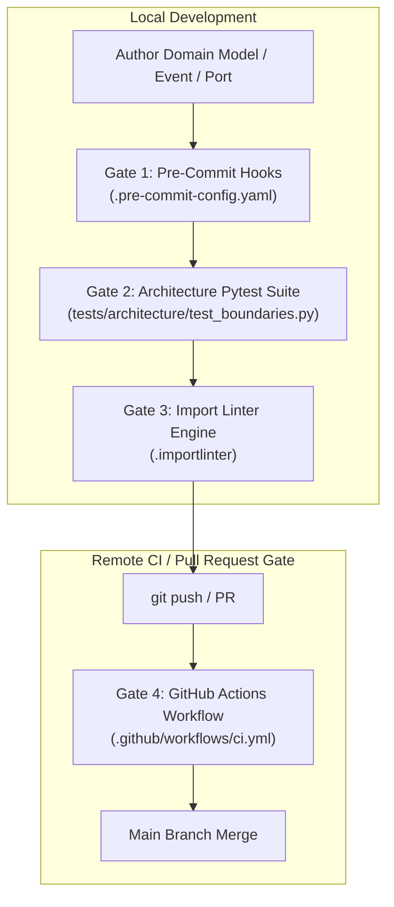

# SDD-003: Domain Scope and Boundary Enforcement Implementation

## 1. Executive Summary & Traceability

In accordance with [ADR 0002: Domain Scope and Boundary Enforcement Mechanics](file:///home/michael/src/github.com/mnaatjes/ed-models/architecture/adr/0002_domain_scope_and_boundary_enforcement.md) and the [Master Risk Register](file:///home/michael/src/github.com/mnaatjes/ed-models/architecture/risk/risk-list.md), this Software Design Document (SDD) specifies the concrete implementation of the automated enforcement mechanisms governing all domain models, events, and static catalogs within `ed-models`.

### Traceability Links
* **Governing ADRs:** [ADR 0001 (Pure Domain Architecture)](file:///home/michael/src/github.com/mnaatjes/ed-models/architecture/adr/0001_ed_models_core_game_logic_and_catalog_architecture.md), [ADR 0002 (Scope & Boundary Enforcement)](file:///home/michael/src/github.com/mnaatjes/ed-models/architecture/adr/0002_domain_scope_and_boundary_enforcement.md)
* **Governed Risks:** `RISK-01` (Catalog Drift), `RISK-02` (Enum Deserialization Crashes), `RISK-03` (Dataclass Inheritance Collisions), `RISK-04` (Stream Memory Bloat), `RISK-05` (Hexagonal Boundary Leaks)
* **Governing Directives:** `HEXA-TRUTH-01` through `HEXA-TRUTH-17` (`.gemini/rules/hexagonal_invariants.md`)

---

## 2. Enforcement Architecture Overview

Boundary enforcement is implemented across four deterministic, layered verification gates:



---

## 3. Component Design & Technical Specifications

### 3.1 Gate 1: Pre-Commit Configuration (`.pre-commit-config.yaml`)

Enforces baseline source hygiene, formatting, and syntax modernizations before commits land in local git history.

* **Ruff Linter & Formatter (`ruff>=0.7.3`):**
  * Target Python Version: `py312`.
  * Enforces modern typing (`list[T]` over `typing.List[T]`, `T | None` over `typing.Optional[T]`).
  * Enforces strict import ordering (`I`) separating standard library, external packages, and `ed_models` internal layers.
* **File Cleaners:** `end-of-file-fixer` and `trailing-whitespace`.
* **Config Checkers:** `check-toml` and `check-yaml`.

### 3.2 Gate 2: Architecture Pytest Suite (`tests/architecture/test_boundaries.py`)

An AST-based inspection test suite executing within Pytest that validates Python abstract syntax trees across `src/ed_models/`:

#### 1. `test_types_never_imports_events()`
* **Governed Invariant:** ADR 0002 Section 4.1 (`HEXA-TRUTH-06`).
* **Implementation:** Inspects all `.py` files under `src/ed_models/core/domain/types/`. Traverses `ast.Import` and `ast.ImportFrom` nodes. Asserts that no imported module starts with `ed_models.core.domain.events`.

#### 2. `test_events_declare_kw_only_and_slots()`
* **Governed Invariant:** ADR 0002 Section 4.3 (`RISK-03`, `RISK-04`).
* **Implementation:** Inspects all `.py` files under `src/ed_models/core/domain/events/`. For every `ast.ClassDef` decorated with `@dataclass`, inspects decorator keywords to assert `kw_only=True` and `slots=True` are explicitly declared.

#### 3. `test_value_objects_are_frozen()`
* **Governed Invariant:** ADR 0002 Section 4.3 (`HEXA-TRUTH-10`).
* **Implementation:** Inspects all classes in `src/ed_models/core/domain/spatial/` (`Coordinates3D`). Asserts decorator declarations include `frozen=True` and `slots=True`.

#### 4. `test_domain_has_zero_io_imports()`
* **Governed Invariant:** ADR 0002 Section 4.4 (`HEXA-TRUTH-01`, `RISK-05`).
* **Implementation:** Walks all modules under `src/ed_models/core/domain/`. Forbids any import matching `requests`, `httpx`, `urllib`, `socket`, `sqlite3`, `pathlib`, `builtins.open`, or `ed_telemetry`.

### 3.3 Gate 3: Structural Import Linter (`.importlinter`)

Configured in `.importlinter` to verify directional coupling at the package graph level:

```ini
[importlinter]
root_packages =
    ed_models
include_external_packages = True

# Contract 1: Pure Core Domain Layer Isolation (HEXA-TRUTH-01)
[importlinter:contract:core_domain_isolation]
name = Core domain isolation
type = forbidden
source_modules =
    ed_models.core.domain
forbidden_modules =
    ed_models.adapters
    ed_models.bootstrap
    ed_models.core.ports
    ed_models.core.use_cases

# Contract 2: Types Subdomain Directionality (HEXA-TRUTH-06, ADR 0002 §4.1)
[importlinter:contract:types_subdomain_isolation]
name = Types subdomain isolation
type = forbidden
source_modules =
    ed_models.core.domain.types
forbidden_modules =
    ed_models.core.domain.events
    ed_models.core.domain.ships
    ed_models.core.domain.commodities

# Contract 3: Strict Hexagonal Layering (HEXA-TRUTH-02)
[importlinter:contract:hexagonal_layering]
name = Hexagonal layers
type = layers
layers =
    ed_models.bootstrap
    ed_models.adapters
    ed_models.core.use_cases
    ed_models.core.ports
    ed_models.core.domain

# Contract 4: Absolute Zero I/O in Core (ADR 0002 §4.4)
[importlinter:contract:zero_io_in_core]
name = Zero I/O in core
type = forbidden
source_modules =
    ed_models.core
forbidden_modules =
    httpx
    requests
    urllib
    socket
    sqlite3
    ed_telemetry
    ed_transport
    ed_connector
    ed_schema
```

### 3.4 Gate 4: Continuous Integration Workflow (`.github/workflows/ci.yml`)

Executes automatically on pull requests and pushes to `main`:
1. Environment initialization across matrix (`Python 3.12`, `Python 3.13`).
2. Dependency installation via `uv sync --all-extras`.
3. Pre-commit linters: `uv run ruff check .` and `uv run ruff format --check .`.
4. Type checking: `uv run mypy src/ tests/`.
5. Boundary gates: `uv run lint-imports` and `uv run pytest tests/architecture/test_boundaries.py`.
6. Unit & integration test execution: `uv run pytest tests/unit/`.

---

## 4. Verification & Testing Strategy

Execution commands validating boundary compliance:

```bash
# 1. Execute all architectural boundary tests:
.venv/bin/pytest tests/architecture/test_boundaries.py -v

# 2. Execute import linter contracts:
.venv/bin/lint-imports

# 3. Complete Quality Gate:
.venv/bin/python scripts/verify.py
```

---

## 5. Non-Goals & Scope Limits

1. **Model Parsing Logic:** This SDD does not implement the actual data parsing or token normalizers (governed by subsequent feature SDDs).
2. **Schema Generation:** This SDD does not generate or validate external JSON Schemas (governed by `ed-schema`).
3. **Network I/O Handling:** This SDD strictly ensures zero network I/O enters `ed-models`.
