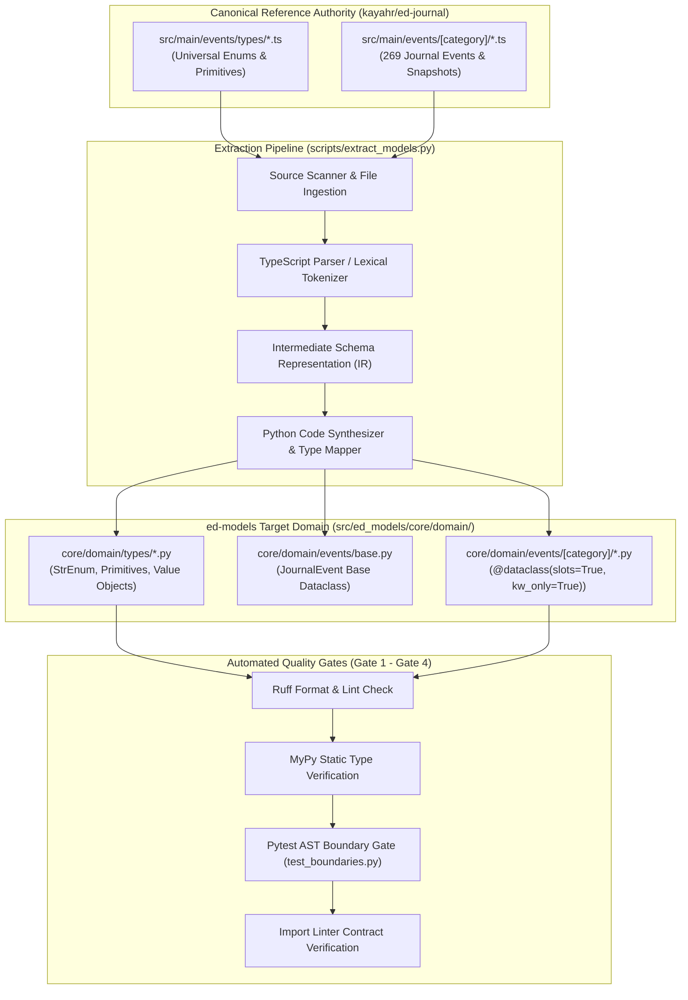

# SDD-004: TypeScript Model Extraction and Domain Transformation Pipeline Implementation

## 1. Executive Summary & Traceability

In accordance with [ADR 0003: TypeScript Model Extraction and Domain Transformation Pipeline](file:///home/michael/src/github.com/mnaatjes/ed-models/architecture/adr/0003_typescript_model_extraction_and_transformation_pipeline.md), [ADR 0002](file:///home/michael/src/github.com/mnaatjes/ed-models/architecture/adr/0002_domain_scope_and_boundary_enforcement.md), and [Note 0012](file:///home/michael/src/github.com/mnaatjes/ed-integration-smoke/architecture/notes/0012_harvested_game_events_and_codification_repositories.md), this Software Design Document (SDD) specifies the concrete implementation of the automated extraction and codification pipeline residing strictly in `scripts/extract_models.py`.

The pipeline ingests TypeScript interfaces and type definitions from `kayahr/ed-journal` (`/home/michael/src/github.com/kayahr/ed-journal/src/main/events/`), transforms them into pure Python domain models, and outputs strongly typed, slotted dataclasses into `src/ed_models/core/domain/`.

### Traceability Links
* **Governing ADRs:** [ADR 0001 (Pure Domain Architecture)](file:///home/michael/src/github.com/mnaatjes/ed-models/architecture/adr/0001_ed_models_core_game_logic_and_catalog_architecture.md), [ADR 0002 (Domain Scope & Boundary Enforcement)](file:///home/michael/src/github.com/mnaatjes/ed-models/architecture/adr/0002_domain_scope_and_boundary_enforcement.md), [ADR 0003 (TypeScript Model Extraction Pipeline)](file:///home/michael/src/github.com/mnaatjes/ed-models/architecture/adr/0003_typescript_model_extraction_and_transformation_pipeline.md)
* **Governed Use Cases:** `UC-02` (Journal Event Hydration), `UC-01` (Token Normalization), `UC-05` (Market Interoperability)
* **Governing Invariants:** `HEXA-TRUTH-01` (Zero I/O in core), `HEXA-TRUTH-06` (Types never import events), `HEXA-TRUTH-10` (Value objects frozen), `RISK-03` (Dataclass inheritance kw_only), `RISK-04` (Slots memory optimization)

---

## 2. Subsystem Architecture Overview

The extraction pipeline operates exclusively as an offline build and code generation tool located in `scripts/`. It has zero presence inside the runtime distribution package `src/ed_models/`.



---

## 3. Detailed Component Design & Specifications

### 3.1 Script Location & Interface Contract (`scripts/extract_models.py`)

* **Execution Working Directory:** Repository root `/home/michael/src/github.com/mnaatjes/ed-models/`.
* **CLI Invocation:**
  ```bash
  .venv/bin/python scripts/extract_models.py \
      --source /home/michael/src/github.com/kayahr/ed-journal/src/main/events \
      --target src/ed_models/core/domain \
      --clean
  ```
* **Arguments:**
  * `--source`: Path to `kayahr/ed-journal/src/main/events/` directory.
  * `--target`: Path to target directory (default: `src/ed_models/core/domain/`).
  * `--clean`: Clean existing generated models before emitting code (preserving custom core entities).

### 3.2 Intermediate Representation (IR) Schema

To decouple parsing from code rendering, the pipeline extracts TypeScript declarations into an intermediate Python dataclass representation:

```python
from dataclasses import dataclass, field
from enum import Enum


class PrimitiveKind(Enum):
    STR = "str"
    INT = "int"
    FLOAT = "float"
    BOOL = "bool"
    ANY = "typing.Any"
    COORDINATES = "Coordinates3D"


@dataclass(slots=True)
class FieldSpec:
    name: str
    type_annotation: str
    is_optional: bool
    default_value: str | None = None
    docstring: str | None = None


@dataclass(slots=True)
class EnumSpec:
    name: str
    docstring: str | None
    members: list[tuple[str, str]]  # (python_name, raw_value)


@dataclass(slots=True)
class DataclassSpec:
    name: str
    category: str
    parent_class: str | None
    docstring: str | None
    fields: list[FieldSpec] = field(default_factory=list)
    nested_classes: list["DataclassSpec"] = field(default_factory=list)
```

### 3.3 Lexical Parsing & Type Mapping Rules

#### 1. Universal Enum Processing (`src/main/events/types/`)
- In `kayahr/ed-journal`, enums are modeled as union literal types (e.g., `export type StarType = "O" | "B" | "A" ...;`).
- The parser extracts all union string values and emits an idiomatic `enum.StrEnum` in `src/ed_models/core/domain/types/<snake_case_name>.py`.
- Member identifiers are normalized:
  - If the literal is a valid identifier (e.g. `"Carrier"`), use the literal name.
  - If the literal has illegal characters or begins with a digit, prefix with `T_` or normalize (e.g. `"1"` $\rightarrow$ `VALUE_1`).

#### 2. Event Interface Processing (`src/main/events/[category]/*.ts`)
- TypeScript interfaces extending `JournalEvent<"EventName">` (or standalone interfaces) are mapped to Python `@dataclass(slots=True, kw_only=True)`.
- **Base Class:** Every journal event inherits from `JournalEvent` defined in `src/ed_models/core/domain/events/base.py`:
  ```python
  from dataclasses import dataclass
  from datetime import datetime


  @dataclass(slots=True, kw_only=True)
  class JournalEvent:
      timestamp: datetime | str
      event: str
  ```
- **Nested Anonymous Interfaces:** TypeScript interfaces with inline object declarations (e.g., `SystemFaction?: { Name: string; FactionState?: string; };`) are hoisted into explicitly named nested value object dataclasses (e.g., `FSDJumpSystemFaction`) placed directly above the parent event definition or in a companion module.
- **Coordinates Mapping:** Fields named `StarPos` with signature `[number, number, number]` are automatically mapped to `Coordinates3D` imported from `ed_models.core.domain.spatial.coordinates`.

#### 3. Companion Snapshot Processing
- Extended snapshots (`Market.ts` with `ExtendedMarket`, `Shipyard.ts` with `ExtendedShipyard`, etc.) are recognized as companion state payloads.
- The pipeline synthesizes dedicated snapshot classes (e.g. `MarketSnapshot`, `ShipyardSnapshot`) extending or composing the base event with item detail lists (`MarketItem`, `ShipyardPrice`, `NavRouteEntry`).

---

## 4. Code Synthesis & Formatting Standards

The synthesizer writes code to disk adhering to repository standards:

1. **Header & License:** Emits standard Python docstring with provenance note acknowledging `kayahr/ed-journal`.
2. **Standard Imports:**
   - Standard library: `from dataclasses import dataclass, field`, `from enum import StrEnum`, `from datetime import datetime`.
   - Internal imports: `from ed_models.core.domain.events.base import JournalEvent`, `from ed_models.core.domain.spatial.coordinates import Coordinates3D`, `from ed_models.core.domain.types...`.
3. **Module Index Exports (`__init__.py`):**
   - Each category directory (`startup/`, `travel/`, `combat/`, etc.) generates an `__init__.py` exposing `__all__` containing all event dataclasses in that domain.
   - The master `core/domain/events/__init__.py` re-exports all categories for ergonomic access.

---

## 5. Verification & Compliance Verification Strategy

To guarantee that generated code satisfies all hexagonal and safety constraints:

1. **Gate 1 (Pre-commit & Ruff):**
   - After code generation, the pipeline executes `ruff format` and `ruff check --fix` over `src/ed_models/core/domain/`.
2. **Gate 2 (Static Typing):**
   - Runs `mypy src/ tests/` ensuring complete type soundness with zero untyped definitions.
3. **Gate 3 (AST Boundary Suite):**
   - Runs `pytest tests/architecture/test_boundaries.py` validating:
     - `test_types_never_imports_events()`: Verifies `types/` never imports `events/`.
     - `test_events_declare_kw_only_and_slots()`: Verifies all 269 events declare `slots=True` and `kw_only=True`.
     - `test_value_objects_are_frozen()`: Verifies nested value objects declare `frozen=True`.
     - `test_domain_has_zero_io_imports()`: Verifies no files in `core/domain/` import `os`, `sys`, `socket`, `pathlib`, `httpx`, or file I/O primitives.
4. **Gate 4 (Import Linter):**
   - Executes `lint-imports` ensuring hexagonal layer isolation and subpackage boundaries remain unbroken.

---

## 6. Implementation Checklist & Operational Plan

| Task ID | Component | Description | Target Path |
| :--- | :--- | :--- | :--- |
| **TSK-01** | `base.py` | Create pure `JournalEvent` base dataclass | `src/ed_models/core/domain/events/base.py` |
| **TSK-02** | `extract_models.py` | Implement TypeScript scanner and AST tokenizer | `scripts/extract_models.py` |
| **TSK-03** | `extract_models.py` | Implement type mappings, hoister, and code synthesizer | `scripts/extract_models.py` |
| **TSK-04** | Generation Run | Execute script against `kayahr/ed-journal/src/main/events/` | `src/ed_models/core/domain/` |
| **TSK-05** | Quality Verification | Execute `.venv/bin/python scripts/verify.py` to achieve 100% compliance | Repository root |
