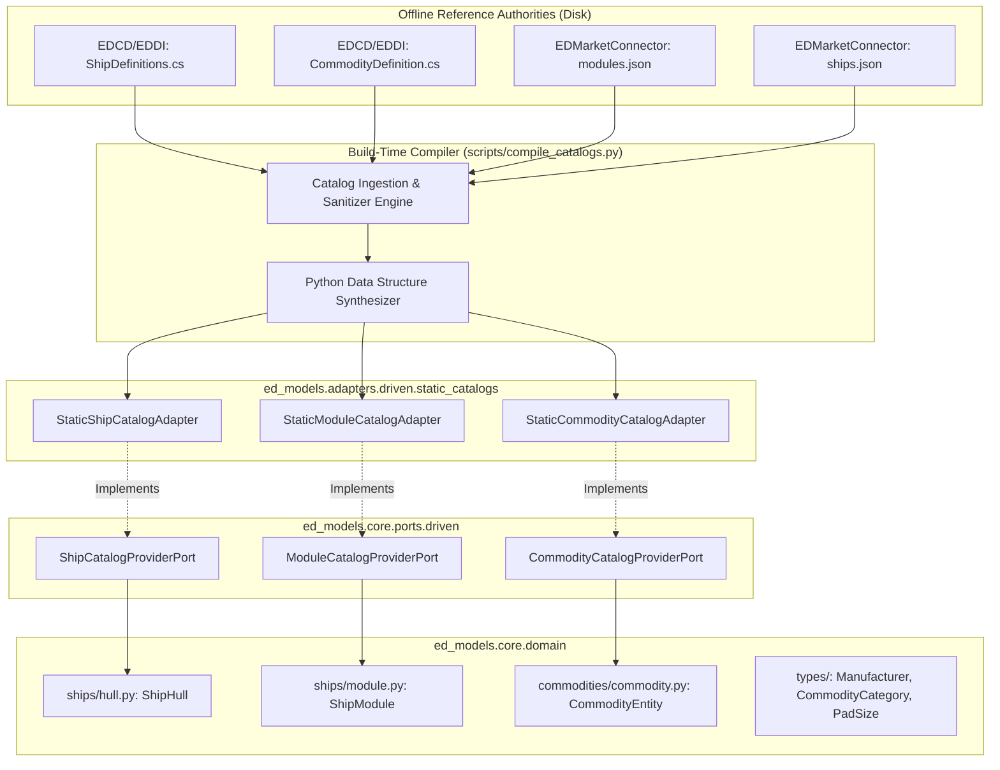

# SDD-005: Static Catalogs and Domain Entity Implementation

## 1. Executive Summary & Traceability

In accordance with [ADR 0004: Static Catalogs and Domain Entity Codification Architecture](file:///home/michael/src/github.com/mnaatjes/ed-models/architecture/adr/0004_static_catalogs_and_domain_entity_codification.md), [ADR 0001](file:///home/michael/src/github.com/mnaatjes/ed-models/architecture/adr/0001_ed_models_core_game_logic_and_catalog_architecture.md), and [ADR 0002](file:///home/michael/src/github.com/mnaatjes/ed-models/architecture/adr/0002_domain_scope_and_boundary_enforcement.md), this Software Design Document (SDD) specifies the concrete implementation of:
1. Pure domain entities for vessels (`ShipHull`), modules (`ShipModule`), commodities (`CommodityEntity`), and telemetry (`StatusTelemetry`).
2. Secondary driven catalog provider ports in `core/ports/driven/`.
3. The offline catalog compilation tool `scripts/compile_catalogs.py`.
4. In-memory driven catalog adapters in `adapters/driven/static_catalogs/`.

### Traceability Links
* **Governing ADRs:** [ADR 0001 (Pure Domain Architecture)](file:///home/michael/src/github.com/mnaatjes/ed-models/architecture/adr/0001_ed_models_core_game_logic_and_catalog_architecture.md), [ADR 0002 (Scope & Boundaries)](file:///home/michael/src/github.com/mnaatjes/ed-models/architecture/adr/0002_domain_scope_and_boundary_enforcement.md), [ADR 0004 (Static Catalogs & Domain Entities)](file:///home/michael/src/github.com/mnaatjes/ed-models/architecture/adr/0004_static_catalogs_and_domain_entity_codification.md)
* **Governed Use Cases:** `UC-01` (Token Normalization), `UC-04` (Jump Range Physics Calculation), `UC-05` (Market Interoperability)
* **Governing Invariants:** `HEXA-TRUTH-01` (Zero I/O in core), `HEXA-TRUTH-02` (Inward Dependency Direction), `HEXA-TRUTH-03` (Abstract Protocols for Ports), `HEXA-TRUTH-04` (DTO Purity), `HEXA-TRUTH-10` (Immutability).

---

## 2. Subsystem Architecture Overview



---

## 3. Detailed Component Design & Specifications

### 3.1 Domain Entities (`src/ed_models/core/domain/`)

#### 1. Ship Hull (`src/ed_models/core/domain/ships/hull.py`)
```python
from dataclasses import dataclass, field
from ed_models.core.domain.types.manufacturer import Manufacturer
from ed_models.core.domain.types.pad_size import PadSize


@dataclass(slots=True, kw_only=True)
class ShipHull:
    """Immutable ship hull specification."""

    model: str
    name: str
    manufacturer: Manufacturer
    pad_size: PadSize
    hull_mass: float
    reserve_fuel_capacity: float
    military_slots: dict[str, int] = field(default_factory=dict)
```

#### 2. Ship Module (`src/ed_models/core/domain/ships/module.py`)
```python
from dataclasses import dataclass


@dataclass(slots=True, kw_only=True)
class ShipModule:
    """Ship module and outfitting equipment."""

    fdev_id: int
    symbol: str
    name: str
    class_num: int
    rating: str
    mass: float
    power_draw: float | None = None
```

#### 3. Commodity Entity (`src/ed_models/core/domain/commodities/commodity.py`)
```python
from dataclasses import dataclass
from ed_models.core.domain.types.commodity_category import CommodityCategory


@dataclass(slots=True, kw_only=True)
class CommodityEntity:
    """Trade good and market commodity entity."""

    fdev_id: int
    symbol: str
    name: str
    category: CommodityCategory
    average_price: int
    is_rare: bool = False
```

#### 4. Supporting Enums (`src/ed_models/core/domain/types/`)
- `Manufacturer`: `FaulconDeLacy`, `CoreDynamics`, `Gutamaya`, `LakonSpaceways`, `SaudKruger`, `ZorgonPeterson`.
- `PadSize`: `Small`, `Medium`, `Large`, `None`.
- `CommodityCategory`: `Chemicals`, `ConsumerItems`, `Foods`, `IndustrialMaterials`, `LegalDrugs`, `Machinery`, `Medicines`, `Metals`, `Minerals`, `Salvage`, `Slaves`, `Technology`, `Textiles`, `Waste`, `Weapons`, `NonMarketable`, `Unknown`.

---

### 3.2 Driven Secondary Ports (`src/ed_models/core/ports/driven/`)

All ports define `@typing.runtime_checkable` abstract `typing.Protocol` interfaces:

```python
import typing
from ed_models.core.domain.commodities.commodity import CommodityEntity
from ed_models.core.domain.ships.hull import ShipHull
from ed_models.core.domain.ships.module import ShipModule


@typing.runtime_checkable
class ShipCatalogProviderPort(typing.Protocol):
    """Port for querying pre-compiled ship hull metadata."""

    def get_hull_spec(self, model: str) -> ShipHull | None: ...
    def list_all_hulls(self) -> list[ShipHull]: ...


@typing.runtime_checkable
class ModuleCatalogProviderPort(typing.Protocol):
    """Port for querying outfitting modules."""

    def get_module_by_id(self, fdev_id: int) -> ShipModule | None: ...
    def get_module_by_symbol(self, symbol: str) -> ShipModule | None: ...


@typing.runtime_checkable
class CommodityCatalogProviderPort(typing.Protocol):
    """Port for querying canonical market commodities."""

    def get_commodity_by_id(self, fdev_id: int) -> CommodityEntity | None: ...
    def get_commodity_by_symbol(self, symbol: str) -> CommodityEntity | None: ...
```

---

### 3.3 Driven Catalog Adapters (`src/ed_models/adapters/driven/static_catalogs/`)

1. **`StaticShipCatalogAdapter` (`ships_catalog.py`):**
   - Implements `ShipCatalogProviderPort`.
   - Stores pre-compiled frozen mapping `_HULLS: dict[str, ShipHull]` keyed by lowercase normalized model symbol (e.g. `"anaconda"`, `"krait_mkii"`, `"python"`).
   - $O(1)$ dictionary lookup.

2. **`StaticModuleCatalogAdapter` (`modules_catalog.py`):**
   - Implements `ModuleCatalogProviderPort`.
   - Stores pre-compiled mapping `_BY_ID: dict[int, ShipModule]` and `_BY_SYMBOL: dict[str, ShipModule]`.
   - $O(1)$ dictionary lookup.

3. **`StaticCommodityCatalogAdapter` (`commodities_catalog.py`):**
   - Implements `CommodityCatalogProviderPort`.
   - Stores pre-compiled mapping `_BY_ID: dict[int, CommodityEntity]` and `_BY_SYMBOL: dict[str, CommodityEntity]`.
   - Provides fallback resolving unknown commodity symbols to a synthetic `CommodityEntity` with category `CommodityCategory.Unknown` preventing crashes (`RISK-02`).

---

### 3.4 Compiler Script (`scripts/compile_catalogs.py`)

- **Location:** `scripts/compile_catalogs.py`
- **Execution:**
  ```bash
  .venv/bin/python scripts/compile_catalogs.py \
      --eddi /home/michael/src/github.com/EDCD/EDDI \
      --edmc /home/michael/src/github.com/mnaatjes/EDMarketConnector \
      --target src/ed_models/adapters/driven/static_catalogs
  ```
- **Parsing Strategy:**
  - Extracts 48 ship hull definitions from `EDCD/EDDI/DataDefinitions/ShipDefinitions.cs` cross-referenced with `EDMarketConnector/ships.json` for precise hull masses and reserve fuel values.
  - Extracts 1,169 module definitions from `EDMarketConnector/modules.json`.
  - Extracts 450+ commodity definitions and category classifications from `EDCD/EDDI/DataDefinitions/CommodityDefinition.cs`.
  - Generates typed Python code files formatted with `ruff`.

---

## 4. Verification and Boundary Compliance

1. **Gate 1 (Pre-commit):** Formats generated catalog adapters via `ruff format` and passes all linter checks.
2. **Gate 2 (Static Typing):** `mypy src/ tests/` confirms zero typing errors across catalog lookups.
3. **Gate 3 (AST Boundary Suite):**
   - Validates that `core/domain/ships/`, `commodities/`, and `types/` import zero outer layers.
   - Validates that `adapters/driven/static_catalogs/` depends only on `core/domain/` and `core/ports/driven/`.
4. **Gate 4 (Import Linter):**
   - Verifies layer contract (`bootstrap` $\rightarrow$ `adapters` $\rightarrow$ `use_cases` $\rightarrow$ `ports` $\rightarrow$ `domain`) remains unbroken.

---

## 5. Implementation Checklist

| Task ID | Component | Target Path |
| :--- | :--- | :--- |
| **TSK-01** | Supporting Enums | `src/ed_models/core/domain/types/manufacturer.py`, `pad_size.py`, `commodity_category.py` |
| **TSK-02** | Domain Entities | `src/ed_models/core/domain/ships/hull.py`, `module.py`, `commodities/commodity.py` |
| **TSK-03** | Driven Ports | `src/ed_models/core/ports/driven/ship_catalog_port.py`, `module_catalog_port.py`, `commodity_catalog_port.py` |
| **TSK-04** | Harvester Script | `scripts/compile_catalogs.py` |
| **TSK-05** | Catalog Generation | `src/ed_models/adapters/driven/static_catalogs/` |
| **TSK-06** | Quality Verification | `.venv/bin/python scripts/verify.py` |
