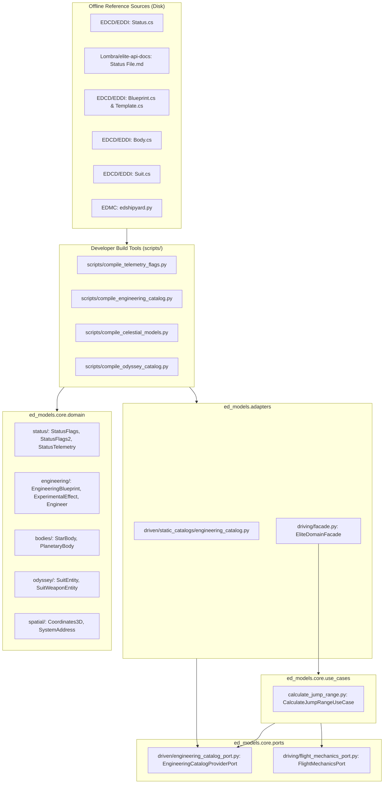

# SDD-006: Harvesting and Codification of Remaining Game Domains Implementation

## 1. Executive Summary & Traceability

In accordance with [ADR 0005: Harvesting and Codification of Remaining Game Domains](file:///home/michael/src/github.com/mnaatjes/ed-models/architecture/adr/0005_harvesting_and_codification_of_remaining_game_domains.md), [ADR 0001](file:///home/michael/src/github.com/mnaatjes/ed-models/architecture/adr/0001_ed_models_core_game_logic_and_catalog_architecture.md), [ADR 0002](file:///home/michael/src/github.com/mnaatjes/ed-models/architecture/adr/0002_domain_scope_and_boundary_enforcement.md), and [ADR 0004](file:///home/michael/src/github.com/mnaatjes/ed-models/architecture/adr/0004_static_catalogs_and_domain_entity_codification.md), this Software Design Document (SDD) specifies the concrete implementation of:

1. **Cockpit Telemetry Bitmasks & Decoders:** `StatusFlags` and `StatusFlags2` (`IntFlag`) and `StatusTelemetry` in `core/domain/status/`.
2. **Engineering Domain Entities & Static Catalogs:** `EngineeringBlueprint`, `BlueprintGrade`, `ExperimentalEffect`, and `EngineerEntity` in `core/domain/engineering/` and driven provider `adapters/driven/static_catalogs/engineering_catalog.py`.
3. **Celestial Bodies Physics Models:** `StarBody` and `PlanetaryBody` in `core/domain/bodies/` with physical and orbital attribute validation.
4. **Odyssey Suits & Loadouts:** `SuitEntity`, `SuitModEntity`, and `SuitWeaponEntity` in `core/domain/odyssey/` and `core/domain/types/suit.py`.
5. **Flight Mechanics Interactor:** `CalculateJumpRangeUseCase` and `FlightMechanicsPort` in `core/use_cases/` and `core/ports/driving/`.
6. **Deterministic Compilation Tools:** Build tools in `scripts/` extracting and synthesizing these models from offline reference repositories (`EDCD/EDDI`, `Lombra/elite-api-docs`, `EDMarketConnector`).

### Traceability Matrix
* **Governing ADRs:** [ADR 0001 (Pure Hexagonal Architecture)](file:///home/michael/src/github.com/mnaatjes/ed-models/architecture/adr/0001_ed_models_core_game_logic_and_catalog_architecture.md), [ADR 0002 (Domain Scope)](file:///home/michael/src/github.com/mnaatjes/ed-models/architecture/adr/0002_domain_scope_and_boundary_enforcement.md), [ADR 0004 (Static Catalogs)](file:///home/michael/src/github.com/mnaatjes/ed-models/architecture/adr/0004_static_catalogs_and_domain_entity_codification.md), [ADR 0005 (Harvesting Missing Domains)](file:///home/michael/src/github.com/mnaatjes/ed-models/architecture/adr/0005_harvesting_and_codification_of_remaining_game_domains.md).
* **Hexagonal Invariants:** `HEXA-TRUTH-01` (Zero I/O in core), `HEXA-TRUTH-02` (Inward dependencies), `HEXA-TRUTH-03` (Protocols for ports), `HEXA-TRUTH-04` (DTO purity), `HEXA-TRUTH-07` (DomainError hierarchy), `HEXA-TRUTH-14` (Stateless interactors).

---

## 2. Architecture & Subsystem Layout



---

## 3. Data Structure Specifications

### 3.1 Cockpit Telemetry (`core/domain/status/`)
* **`StatusFlags(IntFlag)`**: 32 discrete bits representing primary ship states (Docked, Landed, LandingGearDown, ShieldsUp, Supercruise, FlightAssistOff, HardpointsDeployed, InWing, LightsOn, CargoScoopDeployed, SilentRunning, ScoopingFuel, SrvHandbrake, SrvUsingTurret, SrvTurretRetracted, SrvDriveAssist, FsdMassLocked, FsdCharging, FsdCooldown, LowFuel, Overheating, HasLatLong, IsInDanger, BeingInterdicted, InMainShip, InFighter, InSRV, HudInAnalysisMode, NightVision, AltitudeFromAverageRadius, FsdJump, SrvHighBeam).
* **`StatusFlags2(IntFlag)`**: 20 discrete bits representing Odyssey and advanced states (OnFoot, InTaxi, InMulticrew, OnFootInStation, OnFootOnPlanet, AimDownSight, LowOxygen, LowHealth, Cold, Heat, VeryCold, VeryHeat, GlideMode, OnFootInHangar, OnFootSocialSpace, OnFootExterior, BreathableAtmosphere, TelepresenceMulticrew, PhysicalMulticrew, Hyperdrive).
* **`StatusTelemetry(dataclass, slots=True, kw_only=True)`**: Unpacked telemetry payload capturing coordinates, fuel tanks, cargo count, active pips (sys, eng, wpn), and firegroups.

### 3.2 Engineering Catalogs (`core/domain/engineering/`)
* **`EngineeringBlueprint(dataclass, slots=True, kw_only=True)`**:
  - `symbol: str` (Canonical identifier, e.g., `FSD_LongRange`)
  - `name: str` (Localized name, e.g., "Increased Range")
  - `grades: dict[int, BlueprintGrade]` (Grades 1 through 5)
  - `target_modules: tuple[str, ...]` (Applicable module categories)
* **`BlueprintGrade(dataclass, slots=True, kw_only=True)`**:
  - `grade: int` (1-5)
  - `ingredients: tuple[RecipeIngredient, ...]` (Material symbol and quantity)
  - `modifiers: tuple[AttributeModifier, ...]` (Target attribute, change direction, min/max multiplier)
* **`ExperimentalEffect(dataclass, slots=True, kw_only=True)`**:
  - `symbol: str` (e.g., `Special_FSD_MassManager`)
  - `name: str` ("Mass Manager")
  - `ingredients: tuple[RecipeIngredient, ...]`
  - `modifiers: tuple[AttributeModifier, ...]`
* **`EngineerEntity(dataclass, slots=True, kw_only=True)`**:
  - `engineer_id: int` (Frontier Engineer ID)
  - `name: str` (e.g., "Felicity Farseer")
  - `system_name: str` ("Deciat")
  - `station_name: str` ("Farseer Inc")
  - `coordinates: Coordinates3D`
  - `specialties: tuple[str, ...]`

### 3.3 Celestial Bodies (`core/domain/bodies/`)
* **`StarBody(dataclass, slots=True, kw_only=True)`**:
  - `body_id: int`
  - `name: str`
  - `star_type: StarType`
  - `solar_masses: float`
  - `solar_radii: float`
  - `surface_temperature_k: float`
  - `luminosity_class: str`
  - `is_main_star: bool`
* **`PlanetaryBody(dataclass, slots=True, kw_only=True)`**:
  - `body_id: int`
  - `name: str`
  - `planet_class: PlanetClass`
  - `earth_masses: float`
  - `radius_km: float`
  - `surface_gravity_g: float` (Validated against Newtonian formula: $g = G \cdot M / r^2$)
  - `surface_pressure_atm: float`
  - `is_landable: bool`
  - `atmosphere_type: str`
  - `volcanism: str | None`

### 3.4 Odyssey Assets (`core/domain/odyssey/`)
* **`SuitEntity(dataclass, slots=True, kw_only=True)`**:
  - `suit_id: int`
  - `symbol: str` (e.g., `tacticalsuit_class1`)
  - `name: str` ("Dominator Suit")
  - `primary_weapons_capacity: int`
  - `secondary_weapons_capacity: int`
  - `base_shields: float`
  - `base_health: float`
  - `mod_slots: int`
* **`SuitWeaponEntity(dataclass, slots=True, kw_only=True)`**:
  - `weapon_id: int`
  - `symbol: str` (e.g., `wpn_m_assaultrifle_plasma`)
  - `name: str` ("Aphelion")
  - `damage_type: str` ("Plasma")
  - `clip_size: int`
  - `fire_rate: float`

### 3.5 Flight Mechanics & Jump Range Interactor (`core/use_cases/calculate_jump_range.py`)
Implements the exact Frontier FSD jump mechanics:
$$D_{\text{jump}} = \left( \frac{F_{\text{opt}}}{M_{\text{total}}} \right)^{\frac{1}{P}} \cdot \left( \frac{f_{\text{max}}}{C_{\text{fuel}}} \right)^{\frac{1}{P}}$$
Where:
- $F_{\text{opt}}$ = FSD optimal mass (metric tons)
- $M_{\text{total}} = M_{\text{unladen}} + M_{\text{cargo}} + M_{\text{fuel}}$
- $f_{\text{max}}$ = Maximum fuel per jump for the FSD rating
- $C_{\text{fuel}}$ = Fuel multiplier constant (from FSD rating)
- $P$ = Fuel power exponent (rating dependent, typically $2.0$ to $2.75$)

---

## 4. Port Specifications & Test Doubles

### 4.1 Driven Ports (`core/ports/driven/`)
```python
from typing import Protocol, runtime_checkable
from ed_models.core.ports.base import DrivenPort
from ed_models.core.domain.engineering import EngineeringBlueprint, ExperimentalEffect, EngineerEntity

@runtime_checkable
class EngineeringCatalogProviderPort(DrivenPort, Protocol):
    """Secondary port providing engineering blueprint lookups."""
    def get_blueprint(self, symbol: str) -> EngineeringBlueprint | None: ...
    def get_experimental_effect(self, symbol: str) -> ExperimentalEffect | None: ...
    def get_engineer(self, engineer_id: int) -> EngineerEntity | None: ...
    def list_engineers(self) -> tuple[EngineerEntity, ...]: ...
```

### 4.2 Driving Port (`core/ports/driving/flight_mechanics_port.py`)
```python
from typing import Protocol, runtime_checkable
from ed_models.core.domain.flight import JumpCalculationResult, JumpCalculationParameters

@runtime_checkable
class FlightMechanicsPort(Protocol):
    """Primary driving port for vessel physics and jump mechanics."""
    def calculate_jump_range(self, params: JumpCalculationParameters) -> JumpCalculationResult: ...
```

### 4.3 Test Doubles Parity (`tests/doubles/fake_engineering_catalog.py`)
In accordance with `tests/architecture/test_boundaries.py`, all new driven ports must have an in-memory double in `tests/doubles/`:
* `FakeEngineeringCatalogProviderAdapter` providing standard canned engineering blueprints (`FSD_LongRange`, `Special_FSD_MassManager`, `Felicity Farseer`).

---

## 5. Offline Build Pipelines (`scripts/`)

Build tools in `scripts/` will operate completely independent of runtime execution:

1. `scripts/compile_telemetry_flags.py`: Ingests Markdown / C# bitfield tables, validating unique powers of 2 ($2^0 \dots 2^{31}$ and $2^0 \dots 2^{19}$), outputting `src/ed_models/core/domain/status/flags.py`.
2. `scripts/compile_engineering_catalog.py`: Ingests `Blueprint.cs` and `BlueprintTemplate.cs` from EDDI, outputting frozen dictionaries to `src/ed_models/adapters/driven/static_catalogs/engineering_catalog.py`.
3. `scripts/compile_celestial_models.py`: Synthesizes star and planet types into `src/ed_models/core/domain/bodies/`.
4. `scripts/compile_odyssey_catalog.py`: Compiles Odyssey suits, weapons, and modifications into `src/ed_models/adapters/driven/static_catalogs/odyssey_catalog.py`.

---

## 6. Verification and Quality Gates

All generated domain entities, adapters, and ports must satisfy the four project quality gates:
1. **Linter Gate:** `ruff check . && ruff format --check .` (0 errors).
2. **Boundary Gate:** `pytest tests/architecture/test_boundaries.py` & `lint-imports` (verifying `DrivenPort` inheritance and fake parity).
3. **Type Safety Gate:** `mypy src/ tests/` (strict mode, zero errors).
4. **Unit Test Gate:** 100% passing tests for bitmask operations, engineering lookups, and jump range physics.
