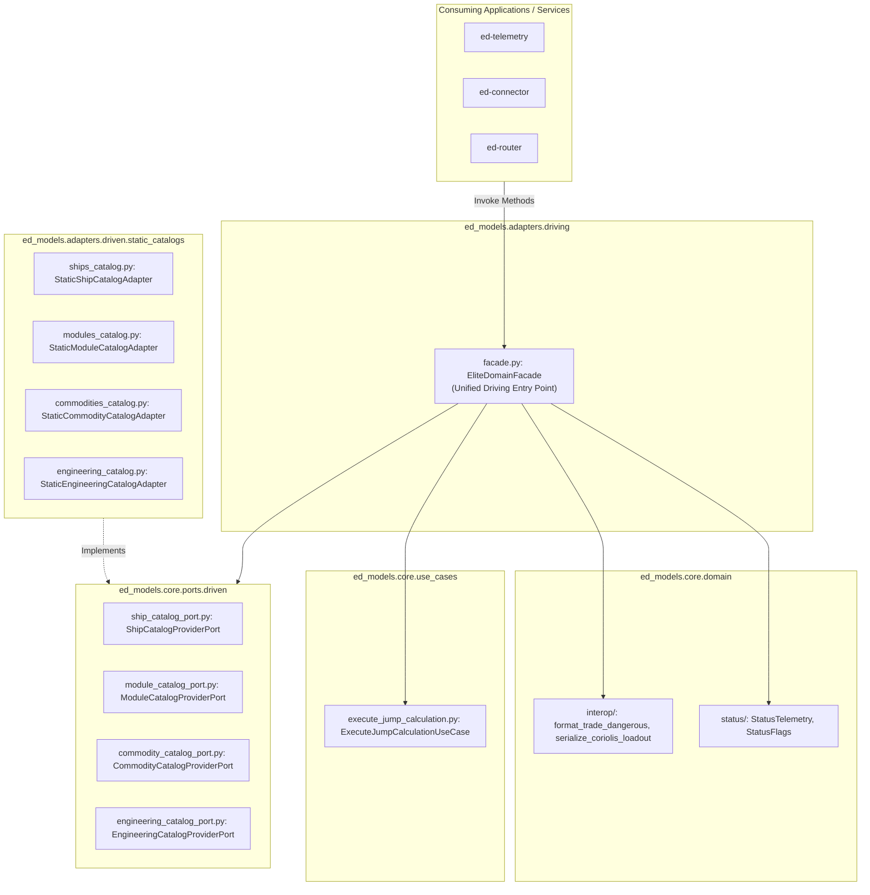

# SDD-008: Driving Facade Capability Boundaries Implementation

## 1. Executive Summary & Traceability

In accordance with [ADR 0007: Driving Facade Capability Boundaries and Method Taxonomy](file:///home/michael/src/github.com/mnaatjes/ed-models/architecture/adr/0007_driving_facade_capability_boundaries_and_method_taxonomy.md), [ADR 0001](file:///home/michael/src/github.com/mnaatjes/ed-models/architecture/adr/0001_ed_models_core_game_logic_and_catalog_architecture.md), and [ADR 0002](file:///home/michael/src/github.com/mnaatjes/ed-models/architecture/adr/0002_domain_scope_and_boundary_enforcement.md), this Software Design Document specifies the implementation of:

1. **The Unified Driving Facade Adapter:** `EliteDomainFacade` in `src/ed_models/adapters/driving/facade.py`.
2. **Composition Root Wiring:** `Container` in `src/ed_models/bootstrap/container.py`.
3. **Automated Architectural AST Enforcement:** `test_facade_driving_adapter_method_boundaries` in `tests/architecture/test_boundaries.py`.

### Traceability Links
* **Governing ADRs:** [ADR 0001 (Hexagonal Architecture)](file:///home/michael/src/github.com/mnaatjes/ed-models/architecture/adr/0001_ed_models_core_game_logic_and_catalog_architecture.md), [ADR 0002 (Domain Scope)](file:///home/michael/src/github.com/mnaatjes/ed-models/architecture/adr/0002_domain_scope_and_boundary_enforcement.md), [ADR 0007 (Facade Boundaries)](file:///home/michael/src/github.com/mnaatjes/ed-models/architecture/adr/0007_driving_facade_capability_boundaries_and_method_taxonomy.md).
* **Governing Invariants:** `HEXA-TRUTH-01` (Zero I/O in core), `HEXA-TRUTH-02` (Inward dependency direction), `HEXA-TRUTH-14` (Stateless interactors).

---

## 2. Architecture & Subsystem Layout

---

## 3. Facade Method Specification

`EliteDomainFacade` exposes strictly bounded methods categorized across the three permitted pillars:

### 3.1 Pillar 1: Static Catalog Lookups ($O(1)$)
* `get_ship(symbol: str) -> ShipHull | None`
* `list_ships() -> list[ShipHull]`
* `get_module_by_id(fdev_id: int) -> ShipModule | None`
* `get_module_by_symbol(symbol: str) -> ShipModule | None`
* `get_commodity_by_id(fdev_id: int) -> CommodityEntity | None`
* `get_commodity_by_symbol(symbol: str) -> CommodityEntity | None`
* `get_blueprint(symbol: str) -> EngineeringBlueprint | None`
* `get_experimental_effect(symbol: str) -> ExperimentalEffect | None`
* `get_engineer(engineer_id: int) -> EngineerEntity | None`
* `list_engineers() -> list[EngineerEntity]`

### 3.2 Pillar 2: Deterministic Token & Telemetry Normalization
* `normalize_commodity(token: str) -> CommodityEntity | None`:
  Strips `$`, `_name;`, and localized casing to resolve against the commodity catalog.
* `parse_telemetry(*, flags: int, flags2: int = 0, pips: tuple[int, int, int] = (4, 4, 4), fuel_main: float = 0.0, fuel_reservoir: float = 0.0, cargo: int = 0, legal_state: str = "Clean") -> StatusTelemetry`:
  Instantiates fully validated `StatusTelemetry` with decomposed bitmasks.

### 3.3 Pillar 3: Pure Mathematical Interactors
* `calculate_jump_range(params: JumpCalculationParameters) -> JumpCalculationResult`:
  Delegates to `ExecuteJumpCalculationUseCase`.
* `format_trade_dangerous(records: list[TradeDangerousMarketRecord], timestamp_str: str) -> str`:
  Formats ASCII Trade Dangerous ledger.
* `serialize_coriolis(loadout: dict[str, object]) -> str`:
  Gzip-compresses and base64-encodes ship loadouts for Coriolis.io URL hashes.

---

## 4. AST Architectural Enforcement Specification

A dedicated architectural test (`test_facade_driving_adapter_method_boundaries`) parses `src/ed_models/adapters/driving/facade.py` and asserts:
1. **Method Name Whitelist:**
   All public methods must begin with: `get_`, `list_`, `normalize_`, `parse_`, `calculate_`, `format_`, `serialize_`.
2. **Forbidden Types Whitelist:**
   No parameter or return type annotation may reference: `Path`, `IO`, `BinaryIO`, `TextIO`, `Socket`, `Request`, `Response`, `Session`, `Cursor`.
3. **Stateless Attribute Invariant:**
   `EliteDomainFacade` must not assign to `self.<var>` outside `__init__`.
